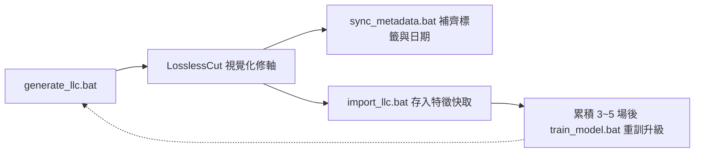

# AutoSlicer-v2 直播歌回打軸標註與無損切片最佳實踐手冊

本手冊彙整了在進行 **LosslessCut 視覺化時間軸微調** 與 **模型訓練數據集標註** 時的核心規範、邊界判定法則、常見邊界案例處置方案與大方向心態指南。

---

## 壹、 核心大方向：宏觀原則與心態

### 1. 「舞台表演事件（Event）」思維 vs「卡拉OK逐字字幕」思維
* **錯誤觀念**：把打軸當成聽打字幕，每句歌詞唱完換氣的 2~3 秒就打一個切點。這樣會切出十幾段無法聆聽的碎骨頭影片，模型也會被教成神經質。
* **正確思維**：打軸是標記**「這首歌的舞台表演從哪裡開始，到哪裡落幕」**。
* 流行歌本來就有 35% ~ 50% 的時間是前奏、間奏、尾奏與換氣停頓，只要這段音樂的整體主角是這首歌，它就是一個**單一且連貫的歌曲區間**。

### 2. 「主角法則」：看這段時間裡誰是核心
* **唱歌是主角，說話/笑場是小插曲** ➔ **整首包成同一個完整區間**（保留現場感）。
* **聊天是主角，唱歌只是隨口哼半句** ➔ **果斷不要標**（讓它自然成為聊天的負樣本）。

### 3. Live 歌回的靈魂：擁抱現場感
* 歌回切片不是冷冰冰的錄音室 CD。主播在間奏時的自嘲、忘詞時的碎碎念、尾奏的隨性哼唱，正是直播歌切最具魅力、最無可替代的「現場生命力」。標註時不要過度潔癖。

---

## 貳、 實戰場景速查手冊

| 場景分類 | 具體特徵描述 | 處置方式 | 核心理由與技術原理 |
| :--- | :--- | :---: | :--- |
| **結尾哼唱** | 伴奏未停，主播跟著尾奏有旋律地哼唱到結束 | **✅ 務必標入** | 哼唱帶有完整音高諧波，屬於 Outro 一部分。若切斷會導致模型未來切片時「吞尾音」。 |
| **唱錯重來（長）** | 唱了 10~15 秒以上發現進錯或沒唱好，隨即倒帶重唱 | **✅ 建議標入** | 具備豐富真實歌聲正樣本。系統內建 `min_song_s = 50s`，即使單獨標也不會切出短廢片。 |
| **唱錯笑場（極短）** | 剛開口唱了 1~3 個字就笑場停下（$< 5$ 秒） | **❌ 略過不標** | 時長太短、邊界模糊，容易把笑聲雜音揉進標籤，直接略過作為負樣本。 |
| **歌中忘詞/插話** | 伴奏持續播放，中途停下來說了兩句（$\le 30 \sim 45$ 秒）又接著唱 | **✅ 一氣呵成包起來** | 系統有 `max_gap_s = 45s` 自動填補機制，千萬不要切成兩半破壞聽感。 |
| **歌中多次斷唱** | 在同一首歌中，斷斷續續停下來講話 2~3 次，但伴奏一直在放 | **✅ 整首包成一首** | 系統填補機制是「逐段獨立判定」而非累計。只要每次停頓 $< 45$ 秒，就是同一首歌。 |
| **開唱前清唱練嗓** | 正式唱歌前清唱了兩句試音，間隔不到 10 秒即正式開唱 | **⭐ 標準歌切：從伴奏起標**<br>（特殊花絮：一口氣包到底） | • 一般歌切從「伴奏響起」起標聽感最乾淨純粹。<br>• 若清唱極具紀念或搞笑價值，包在一起系統亦能完美縫合。 |
| **同首歌重複出現** | 同一場直播唱了兩次同一首歌（如開頭與安可各一次） | **✅ 每一遍都標入** | 模型認的是「人聲特徵」而非歌名。同一首歌不同狀態正好提供最佳的泛化多樣性。 |
| **兩首歌之間的過渡** | 一首歌唱完，換到下一首歌之間的距離 | **$\ge 45$ 秒：果斷分開**<br>（$< 30$ 秒串燒：可合可分） | 超過 45 秒通常是讀彈幕、感謝禮物。分開能為模型提供高品質的聊天負樣本。 |

---

## 參、 系統關鍵演算法參數指南（背後的運作邏輯）

了解 AutoSlicer 底層後處理（`src/postprocess.py`）的三大時間門檻，能讓您在打軸時心中有尺：

```
     0s          8s                  45s                           90s
─────┼───────────┼────────────────────┼─────────────────────────────┼──────────────> (間隔秒數)
  極短噪點     噪聲過濾門檻       同一首歌段內間隙               相鄰段落容差合併帶          必定判定為
(不可單獨存)  (小於此值丟棄)    (自動填補縫合為同一首)         (唱1分-放原唱1分-再唱)       兩首獨立歌曲
```

1. **`max_gap_s = 45 秒`（段內間隔填補門檻）**：
   * 任何歌曲內部的停頓、吉他獨奏、鋼琴間奏，只要長度在 **45 秒以內**，系統會強制視為同一首歌，不會將其切碎。
2. **`merge_gap_s = 90 秒`（相鄰歌曲合併門檻）**：
   * 專為處理「主播唱了一段 ➔ 放了一小段他人原唱對照 ➔ 接著繼續唱」設計。小於 90 秒的關聯演出，系統會傾向於整合成一個完整大切片。
3. **`min_song_s = 50 秒`（最短有效歌曲門檻）**：
   * 任何總長度小於 50 秒的零碎歌唱片段，在自動切片推理時**會被自動過濾丟棄**。因此不必擔心手滑標到短片段會導致資料夾產出一堆 5 秒鐘的垃圾切片。

---

## 肆、 專家級提醒與進階打軸技巧

### 1. 前後預留空間（不必苛求 1 毫秒）
* **前奏起點**：建議抓在**前奏音樂響起前 0.5 ~ 1 秒**（或者主播最後一句雜談結束的安靜處）。AutoSlicer 在切片時自帶 $\pm 5$ 秒吸附緩衝，稍微留一點呼吸空間聽感最舒服。
* **尾奏終點**：抓在**最後一個吉他/鋼琴音符完全自然衰減（Fade-out）沉寂**、或主播切換為說話口氣的第一個字之前。

### 2. 警惕「放 BGM 聊天」被誤標
* 有時主播放著一首好聽的歌當作雜談背景音樂，主播自己從頭到尾都在跟觀眾大聊特聊，偶爾只是跟著拍子哼了兩聲。
* **千萬不要把這種聊天當成歌來標！** 
* 這段音訊正是最完美的「聊天 + BGM 負樣本」，留著它不標，才能教導模型學會**「聊天時背景有歌 $\neq$ 主播在唱歌」**。

### 3. 微調數據的「滾雪球閉環」

* 每次用 LosslessCut 微調完的專案檔（`-proj.llc`），都是經過您雙眼與雙耳驗收的「黃金標準數據」。
* 養成順手拖入 `import_llc.bat` 的習慣，幾秒鐘就能把高精度特徵存入快取，未來主播模型就能不斷自我進化！
